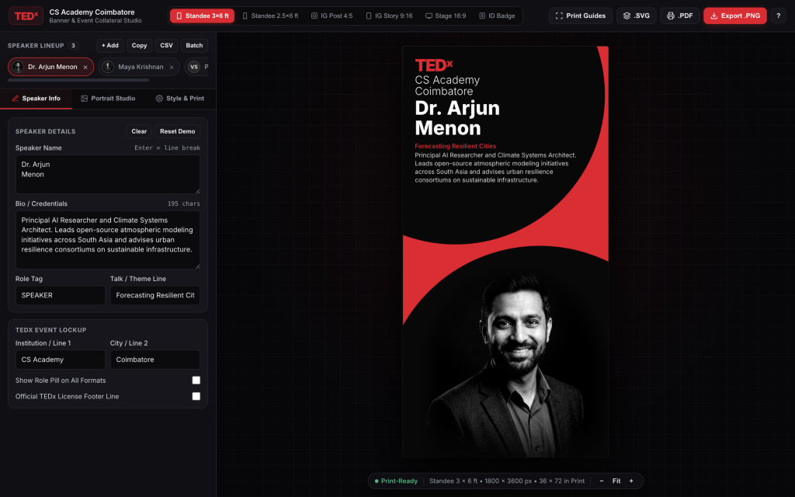
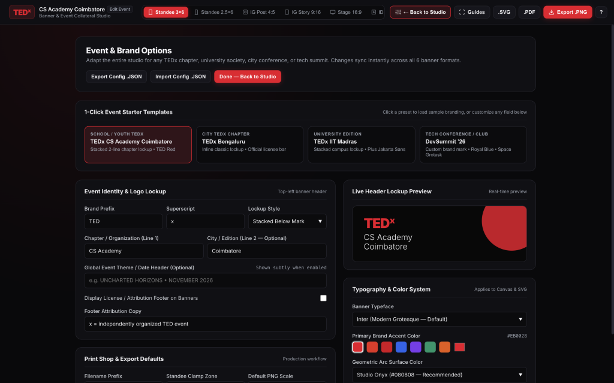

<div align="center">

# TEDx & Conference Banner Studio

**A configurable, browser-native print & social media collateral engine for TEDx chapters, university clubs, and tech conferences.**  
Create print-ready roll-up standees, Instagram speaker reveals, 16:9 auditorium backdrops, and lanyard ID passes in seconds—with zero external dependencies.

[](https://suthirraja22.github.io/tedx-banner-studio/)
[](LICENSE)
[](#engineering-highlights)

<br />



</div>

---

## Overview

Originally engineered for the **TEDx CS Academy Coimbatore** tech team and generalized into a multi-chapter open-source studio, **TEDx & Conference Banner Studio** lets any organizing team configure their own event branding and produce print-shop-ready speaker assets directly in the browser:

- **Full Event & Brand Options Page (`O`)** — Customize your brand prefix & superscript (`TEDx`, `GDG`, `IEEE`, `DevSummit ’26`), switch between **Stacked** and **Inline** chapter lockups, pick fonts (`Inter`, `Helvetica Neue`, `Plus Jakarta Sans`, `Space Grotesk`), change brand accent & dark-arc colors, and export/import shareable `.json` brand configs for your team.
- **1-Click Starter Templates** — Preloaded presets for **School / Youth TEDx**, **City TEDx**, **University Edition**, and **Tech Summits**, or build a custom identity from scratch.
- **Instant Speaker Lineup & CSV Batch Mode** — Manage an entire speaker roster with avatar cards, bulk-import a `.csv` lineup, drop in raw headshots, and batch-export high-DPI `.PNG` banners.
- **Automatic Studio Portrait Blending** — Converts everyday color headshots into high-contrast monochrome portraits clipped inside the lower geometric arc with smoothstep shoulder/edge feathering and bright-background knock-out.
- **Dual Raster & Layered Vector Output** — Export ultra-high-resolution `.PNG` (`up to 3600 × 7200 px`), print-calibrated `.PDF` sheets, or **layered editable `.SVG` files** ready for **Figma, Adobe Illustrator, CorelDRAW, and Canva**.

<div align="center">



</div>

---

## Supported Collateral Formats

| Format | Pixel Dimensions | Aspect / Size | Target Use Case |
| :--- | :--- | :--- | :--- |
| **Standee 3 × 6 ft** | `1800 × 3600 px` *(2x: `3600 × 7200`)* | `1 : 2` (`36 × 72 in`) | Standard campus & auditorium roll-up standees |
| **Standee 2.5 × 6 ft** | `1500 × 3600 px` *(2x: `3000 × 7200`)* | `5 : 12` (`30 × 72 in`) | Narrow flex roll-up standees |
| **IG Post 4:5** | `1080 × 1350 px` | `4 : 5` | Instagram speaker reveal feed posts & carousels |
| **IG Story 9:16** | `1080 × 1920 px` | `9 : 16` | Instagram Stories, Reels covers & vertical signage |
| **Stage Backdrop 16:9** | `1920 × 1080 px` *(2x: `3840 × 2160`)* | `16 : 9` | Auditorium LED walls & projector title slides |
| **ID Badge** | `1050 × 1500 px` | `3.5 × 5 in` (300 DPI) | Speaker, Organizer & Tech Team lanyard passes |

---

## Engineering Highlights

1. **Chord-Constrained Arc Typography Solver**  
   Rather than wrapping text inside static rectangles that collide with curved boundaries, the layout engine evaluates the circular chord bound per line baseline:
   $$x_{\max}(y) = c_x + \sqrt{r^2 - (y - c_y)^2} - m$$
   Paired with an iterative auto-fit solver, long speaker bios dynamically reflow and scale within the upper arc across every aspect ratio without clipping.

2. **Real-Time Offscreen Canvas Portrait Grading**  
   Uploaded portraits pass through a cached offscreen `<canvas>` pixel pipeline applying monochrome contrast curves, luminance-threshold background keying, and an asymmetric radial smoothstep ($3t^2 - 2t^3$) vignette mask—preserving solid lower shoulders while melting outer photo edges seamlessly into the dark arc surface.

3. **Shared Deterministic Layout → Raster & Vector `.SVG` Serialization**  
   A single layout pass drives both the interactive 60 fps `<canvas>` stage and a standards-compliant XML `.SVG` serializer with `<clipPath>`, `<linearGradient>`, and grouped `<text>` layers—bridging automated tech workflows with manual graphic-design handoffs.

4. **Configurable Print-Shop Safeguards & Team `.JSON` Sync**  
   Includes toggleable bleed guides, configurable roll-up standee cassette clamp margins (`0"`, `2.5"`, `3.0"`, `4.0"`), and portable JSON brand configs—all running 100% client-side with zero backend uploads.

---

## Quick Start

Clone the repository and serve the folder with any static HTTP server:

```bash
git clone https://github.com/suthirraja22/tedx-banner-studio.git
cd tedx-banner-studio
python3 -m http.server 8080
```

Then open **`http://localhost:8080`** in your browser.

### Customizing for Your Event / Chapter
1. Click **Event Options** in the top bar (or press `O`, or click the top-left event badge).
2. Choose a **1-Click Starter Template** or customize your **Brand Prefix**, **Chapter Lines**, **Lockup Mode** (`Stacked` vs. `Inline`), **Typeface**, and **Accent Palette**.
3. *(Optional)* Click **Export Config .JSON** to share your exact brand preset with teammates.

---

## Keyboard Shortcuts

| Shortcut | Action |
| :--- | :--- |
| `O` | Open / Close **Event & Brand Options** page |
| `1` – `6` | Switch between Standee, Social, Stage, and Badge formats |
| `G` | Toggle Print Bleed & Standee Roller Clamp Guides |
| `R` | Re-center and reset portrait zoom |
| `↑` `↓` `←` `→` | Fine-nudge speaker portrait position |
| `⌘ / Ctrl + E` | Quick-export high-resolution `.PNG` |
| `?` | Open keyboard shortcuts reference |

---

## Project Structure

```text
tedx-banner-studio/
├── index.html                  # Studio workspace & full Event/Brand Options dashboard
├── styles.css                  # Dynamic CSS variable theme & responsive dark-room UI
├── app.js                      # Configurable brand state, arc solver, pixel shader & exporters
├── speakers_sample.csv         # Sample bulk-import speaker lineup
├── assets/                     # Synthetic studio showcase speaker portraits
├── templates/                  # Standalone editable vector .SVG templates for Figma/Illustrator
├── docs/                       # Interface preview screenshots
├── scripts/
│   └── generate_templates.py   # Utility script to regenerate base .SVG artboards
└── .github/workflows/
    └── deploy-pages.yml        # Automated GitHub Pages deployment workflow
```

---

## Disclaimer & License

- **Sample Assets**: All preloaded speaker names, biographies, and studio portraits in `assets/` are **100% synthetic/fictional** created solely for template demonstration.
- **Trademark Notice**: `TED` and `TEDx` are registered trademarks of TED Conferences, LLC. Event teams should adhere to official [TEDx Brand & Design Guidelines](https://www.ted.com/participate/organize-a-local-tedx-event/tedx-organizer-guide/branding-promotions) when publishing event materials (`x = independently organized TED event`).
- Released under the **[MIT License](LICENSE)** by **[@suthirraja22](https://github.com/suthirraja22)**.
